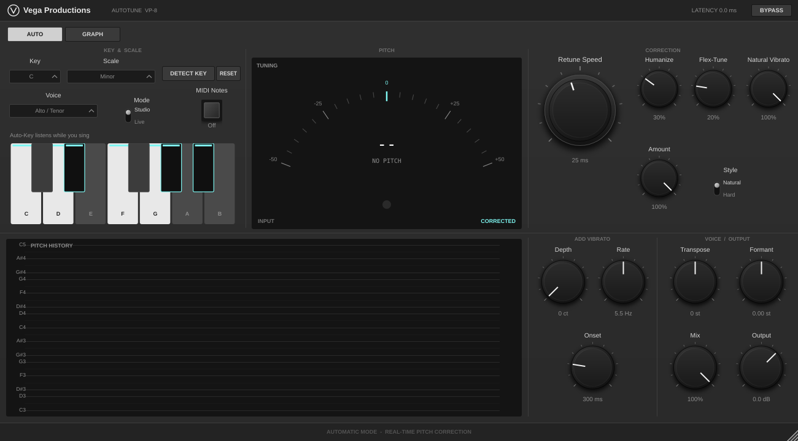
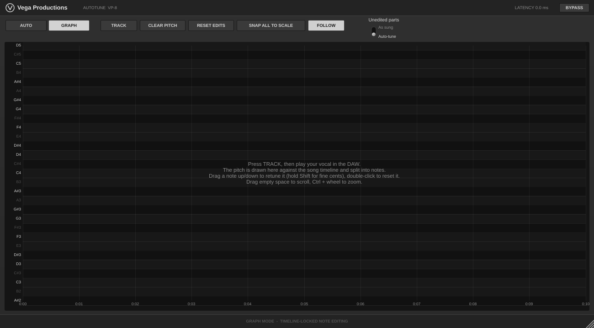

# Vega Productions — Autotune (VP-8)

Real-time vocal pitch correction for the Vega Productions suite. Windows VST3, plus macOS VST3 and AU.

## How it works
- **Pitch detection:** YIN, made fast with FFTs. It tracks bass to soprano (55 Hz–1.2 kHz) and reads within a fraction of a cent on sustained notes. Set **Voice** to your singer's range for the most stable tracking and the lowest latency.
- **Pitch shifting:** pitch-synchronous overlap-add (PSOLA). The voice's formants stay where they are, so corrected and transposed notes keep the singer's natural tone, with no chipmunk effect.

## Auto mode
| Control | What it does |
|---|---|
| **Retune Speed** | How fast notes are pulled in. 0 ms with **Style: Hard** gives the classic robotic effect; 20–60 ms is natural. |
| **Humanize** | Relaxes the correction on long, sustained notes so they don't sound frozen. Short notes still snap. |
| **Flex-Tune** | Only pulls in notes the singer is already close to. Scoops, slides and intentional bends pass through. |
| **Natural Vibrato** | 100% keeps the singer's own vibrato while the note center is corrected; 0% flattens it. |
| **Amount** | Overall strength of the correction. |
| **Add Vibrato** | Adds synthetic vibrato, with Depth, Rate, and an Onset delay so it comes in after the note starts. |
| **Key / Scale** | 10 scales. Click the keyboard to include or exclude any note (switches to Custom). |
| **Detect Key** | Auto-Key: listens while the vocal plays and finds the key (major/minor). **Reset** clears what it has heard. |
| **MIDI Notes** | Send MIDI to the plugin and it tunes to whichever notes you're holding. |
| **Transpose / Formant** | Shift pitch ±12 semitones with formants preserved, or move the formants on their own (±6 st) to make the voice warmer or brighter. |
| **Mode: Studio / Live** | Studio is the most accurate. Live has lower latency for tracking and monitoring. Latency is shown in the top bar and reported to your DAW. |

## Graph mode

1. Click **GRAPH**, then **TRACK**, and play the vocal in your DAW. The pitch is drawn against the song timeline and split into notes.
2. **Drag a note** up or down to retune it (it snaps to semitones; hold **Shift** for fine cents). The singer's vibrato and expression move with it.
3. **Double-click** a note to reset it. **SNAP ALL TO SCALE** retunes every note at once.
4. **Unedited parts**: choose *As sung* (leave them alone) or *Auto-tune* (apply the Auto-mode settings).
5. Drag empty space to scroll, and use Ctrl + mouse wheel to zoom. Tracked pitch and edits are saved with your project.

## Latency
Detecting pitch means hearing at least one or two full cycles of the voice, so true sub-millisecond tuning isn't possible without lowering quality. Typical latency at 48 kHz:

| Voice | Live | Studio |
|---|---|---|
| Soprano | ~14 ms | ~17 ms |
| Alto / Tenor | ~23 ms | ~27 ms |
| Low Male | ~30 ms | ~35 ms |

Your DAW compensates for this automatically on playback. For monitoring while recording, use **Live** with the highest voice range that still fits the singer.

## Install
**Windows (FL Studio):** [download the latest Windows VST3](https://github.com/DJVega70/vega-autotune/releases/latest/download/VegaProductions-Autotune-Windows-VST3.zip), unzip it, and copy `Vega Productions Autotune.vst3` to `C:\Program Files\Common Files\VST3\`. In FL Studio, go to **Options → Manage plugins → Find more plugins**.
For **MIDI Notes** in FL Studio, route a MIDI Out channel to the plugin's MIDI input port (in the wrapper settings).

**Mac:** download `VegaProductions-Autotune-macOS-VST3-AU.zip` from [Releases](https://github.com/DJVega70/vega-autotune/releases/latest).

## Notes on version 1
- Graph mode edits pitch only. Timing edits are not supported yet.
